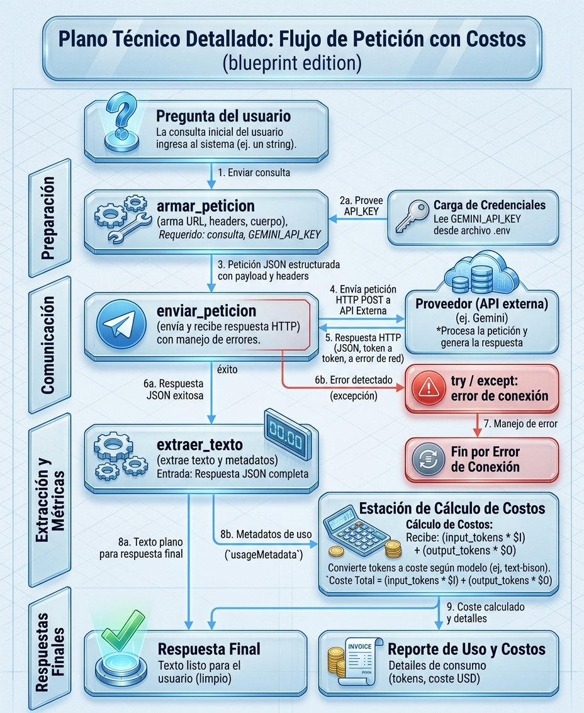

# Decisión de arquitectura: elección de modelo

## Modelo elegido

La implementación actual usa **Gemini 3.5 Flash** (`gemini-3.5-flash`) para generar respuestas. Este modelo aparece configurado en `src/consumir_gemini.py`, `src/monolitico_refactorizado_conExcepciones.py` y `src/monolitico.py`.

En la comparación registrada abajo, el nombre **Modelo A** corresponde al modelo elegido para la aplicación. El código confirma que el modelo implementado es `gemini-3.5-flash`; no identifica el modelo alternativo como Modelo B.

## Diagrama de arquitectura

El flujo robusto de consulta es:

1. `obtener_dato_de_prueba` recibe la pregunta y rechaza valores vacíos.
2. La configuración carga `GEMINI_API_KEY` desde el `.env` del proyecto; si falta o conserva el valor de ejemplo, informa el error.
3. La aplicación prepara el cuerpo de la solicitud y envía una petición `POST` al endpoint `generateContent`, con la clave en el encabezado y un tiempo límite de 30 segundos.
4. La respuesta HTTP se valida. Los errores de conexión, tiempo de espera, estado HTTP, JSON inválido o formato inesperado se convierten en mensajes explícitos.
5. `_extraer_texto` obtiene y concatena las partes de texto del primer candidato, y devuelve la respuesta.

Este flujo corresponde a `src/consumir_gemini.py` y `src/monolitico_refactorizado_conExcepciones.py`. `src/monolitico.py` es una versión más sencilla: construye la URL con la clave y no incluye esas validaciones ni manejo de errores.

## Medición de latencia y estimación de costo

La clase `Latencia`, en `src/latencia.py`, realiza cuatro solicitudes de prueba por defecto usando las funciones de `src/monolitico.py`, imprime el tiempo de cada solicitud y su promedio. Después estima el costo de la última respuesta mediante `calcular_costo`, de `src/costo.py`, usando los contadores de tokens de `usageMetadata`. La prueba se ejecuta al lanzar el módulo o llamar `Latencia.ejecutar()`; importarlo no realiza solicitudes.

Las tarifas configuradas en el script son `0,00000010 USD` por token de entrada y `0,00000030 USD` por token de salida (equivalentes a `0,0001 USD` y `0,0003 USD` por cada 1.000 tokens, respectivamente). Son valores escritos en el código, no una consulta dinámica de precios; deben actualizarse si cambia la tarifa del proveedor.

## Comparación de candidatos registrada

Los valores siguientes se conservaron en la documentación del proyecto con fecha **2026-09-08**. El repositorio no incluye los datos de las tres preguntas y respuestas ni identifica cuál es el Modelo B, por lo que esta comparación es un registro histórico, no un resultado que pueda reproducirse únicamente con el código actual.

| Criterio | Modelo A (implementado como `gemini-3.5-flash`) | Modelo B (alternativa no identificada en el código) |
|---|---:|---:|
| Costo por 1.000 tokens de entrada | 0,0001 USD | 0,0005 USD |
| Costo por 1.000 tokens de salida | 0,0003 USD | 0,0015 USD |
| Latencia promedio registrada | 1,8 segundos | 4,6 segundos |
| Calidad registrada en tres preguntas | Buena: cubrió lo esencial | Muy buena: ofreció más detalle y matices |
| Fecha del registro | 2026-09-08 | 2026-09-08 |

## Justificación

Según la comparación histórica, se eligió el Modelo A porque cubría las necesidades de la miniaplicación con menor costo y latencia que el Modelo B. La calidad de sus respuestas se consideró suficiente para el caso de uso.

## Alternativa descartada y por qué

Se descartó el Modelo B porque, aunque ofrecía respuestas con más detalle y matices, registró mayor costo y latencia, y ese nivel adicional de detalle no se consideró necesario. El código y el registro no identifican el nombre del Modelo B; conviene confirmarlo y repetir la comparación antes de tomar estos resultados como una evaluación vigente.
